# CN Capstone Project - Phase 2 Final Report

**Team:** Netforcers

**Domain:** `app.cn-capstone.test`

**Evidence date:** 22 November 2026

## 1. Scope and evidence

This report updates the Phase 1 architecture and covers mandatory Phase 2 Extensions A-F. The fourteen terminal figures below are **selected, contiguous excerpts** from the team's pasted outputs in the [shared chat](https://chatgpt.com/share/6b03b06a-dd40-83e8-9bf8-6fcc23ebb9a0). Each title bar shows the Mac/person; each footer identifies the source turn and exact line range. They are rendered images of pasted text, not original screen captures or new tests. The matching complete selected source messages are stored in `phase2/evidence/sources/`. Phase 1 packet captures remain historical evidence with earlier DHCP addresses.

## 2. Team, network, and architecture

| Mac | Team member | Phase 2 services | Recorded LAN IP |
|---|---|---|---|
| 1 | Aditya Rana | Primary DNS :53; client | `10.7.17.8` |
| 2 | Krishna | Primary nginx HTTPS :8443; load balancer | `10.7.12.238` |
| 3 | Rachit Gupta | Backend A HTTP :3001; standby nginx HTTPS :8443; pf | `10.7.21.149` |
| 4 | Saumya Mishra | Backend B HTTP :3002; backup DNS :53; pf; client | `10.7.21.214` |

All four Macs used `en0` on `10.7.0.0/19` with gateway `10.7.0.1`. These were DHCP addresses; recheck them before evaluation.

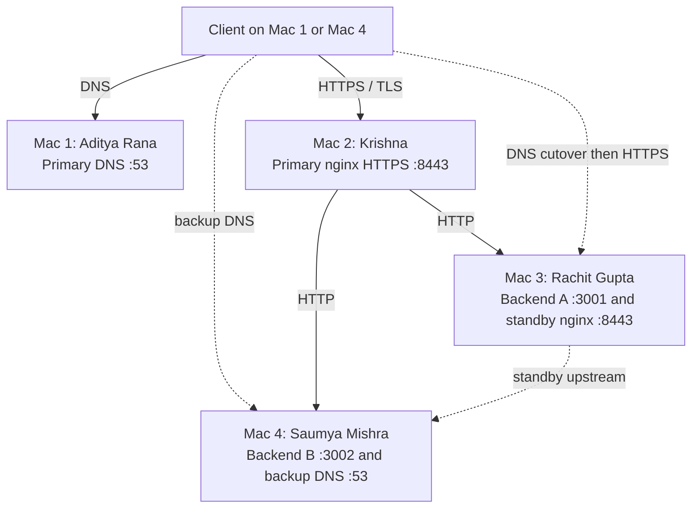

The normal path is client DNS to Mac 1, then client TLS to Mac 2, then HTTP to Mac 3 or Mac 4. During controlled edge migration both DNS servers temporarily pointed to Mac 3. Each physical Mac appears once in the diagram, including Mac 4's two services.

## 3. Phase 2 configuration changes

Phase 1 had one DNS resolver, one HTTPS edge, two REST backends, cache headers, and protocol captures. Phase 2 added backup DNS on Mac 4, backend pf rules, and standby nginx on Mac 3. The versioned configuration bundle is in `phase2/configs/`. Both project DNS configurations set `local-ttl=30`. Backend B's pf exception for Mac 3 supports its standby edge role.

**Troubleshooting during setup:** old Phase 1 backend IPs initially produced nginx 504 responses; the upstream addresses were corrected. Mac 4's scoped resolver initially pointed to an older Mac 1 address and was corrected. A changed authoritative DNS record did not immediately replace a cached answer. The standby edge needs the trusted certificate and backend reachability. The normal HTTPS endpoint uses explicit port `8443`.

## 4. Resilience results and learning

### Extension A - Backup DNS resolver

**Observed:** Mac 4 ran backup dnsmasq with the same project records. The client listed Mac 1 and Mac 4 as DNS servers. A direct query to Mac 4 returned the primary edge address.

**Evidence limit:** The pasted sequence restarts Mac 1 before the later client lookup. Automatic client fallback while Mac 1 remains down still needs a live capture.

**Learning:** A backup resolver only proves resilience when a client resolves during the primary outage.

### Extension B - DNS TTL and controlled record change

**Observed:** Both project DNS configurations use a 30-second local TTL. A temporary caching resolver on Mac 2 kept the old edge address at TTL 1 while primary DNS answered Mac 3, then returned Mac 3 after expiry.

**Evidence limit:** The output proves cache expiry for that temporary resolver. An immediate post-flush macOS client lookup is not captured.

**Learning:** DNS cutover is gradual because cached clients can retain the old address until expiry or a verified cache flush.

### Extension C - Backend service isolation

**Observed:** pf rules were enabled on Macs 3 and 4. Mac 2 reached both backends with HTTP 200; Mac 1 timed out on direct TCP connections to both backend ports.

**Evidence limit:** The rule backups are referenced in the pasted setup, but the final restoration and verification are not captured. Backend B also allows Mac 3 for its standby edge role, an explicit exception to the brief's literal only-Mac-2 rule.

**Learning:** Test the active filter from both permitted and denied sources, then verify rollback.

### Extension D - Backend failure and recovery

**Observed:** With Backend A stopped, six edge requests returned HTTP 200 from B. After A restarted, A appeared again among six successful requests.

**Evidence limit:** The remaining single point of failure in the normal path is Mac 2's edge nginx. A standby edge reduces that risk only after DNS cutover and client cache expiry.

**Learning:** Measure availability at the client through the edge, not only at the backend process.

### Extension E - Controlled edge migration

**Observed:** Standby nginx on Mac 3 listened on 8443 and returned HTTP 200. Both DNS servers were moved to Mac 3, a domain HTTPS request succeeded through nginx/1.31.9, and both records were restored to Mac 2.

**Evidence limit:** The pasted output does not time a cached client continuing to reach the old edge while a fresh lookup reaches Mac 3.

**Learning:** The standby needs the same hostname, trusted certificate, reachable backends, and coordinated DNS records.

### Extension F - Faculty-injected fault

**Observed:** No faculty fault has been injected in the supplied material. The live diagnosis sequence is DNS, TCP, TLS, then HTTP and backend.

**Evidence limit:** Pending evaluation; no result or fix is claimed.

**Learning:** Locate the first failing layer before editing configuration.

## 5. Curated terminal evidence

The figures show the exact selected command/output lines, including failures and prompts where they occur. No result line inside a selected range was removed. Their source messages can be checked against the shared chat.

### 01 Edge Load Balancing - Mac 2 / Krishna

**Supports:** Corrected upstream; six alternating HTTP 200 A/B responses. Source: pasted turn 021, lines 21-75.

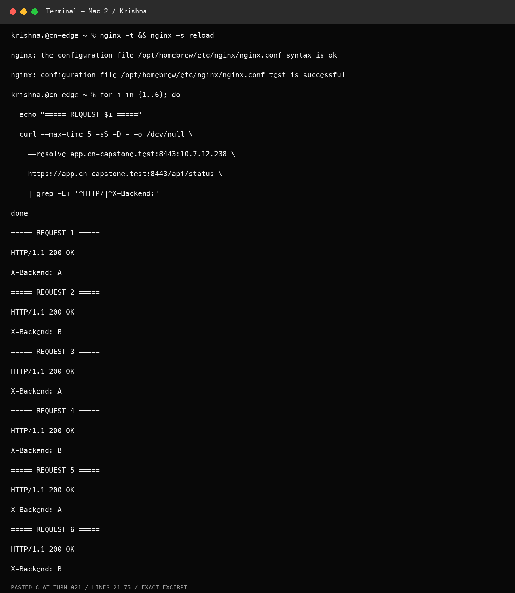

### 02 Client Verified Https - Mac 4 / Saumya Mishra

**Supports:** Strict TLS and HTTP 200 using --resolve; DNS bypassed for this request. Source: pasted turn 027, lines 77-121.

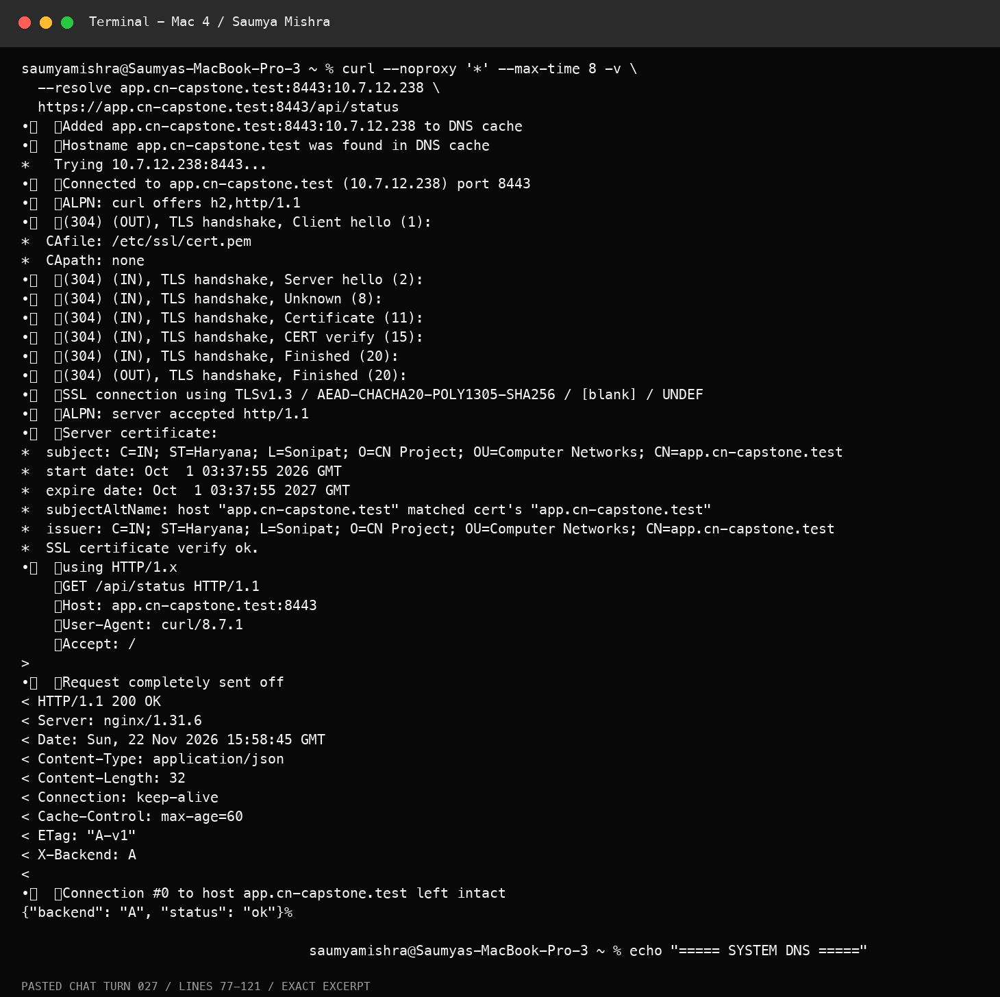

### 03 Client Dual Dns - Mac 4 / Saumya Mishra

**Supports:** Client resolver file lists both DNS servers; domain HTTPS succeeds. Source: pasted turn 029, lines 12-45.

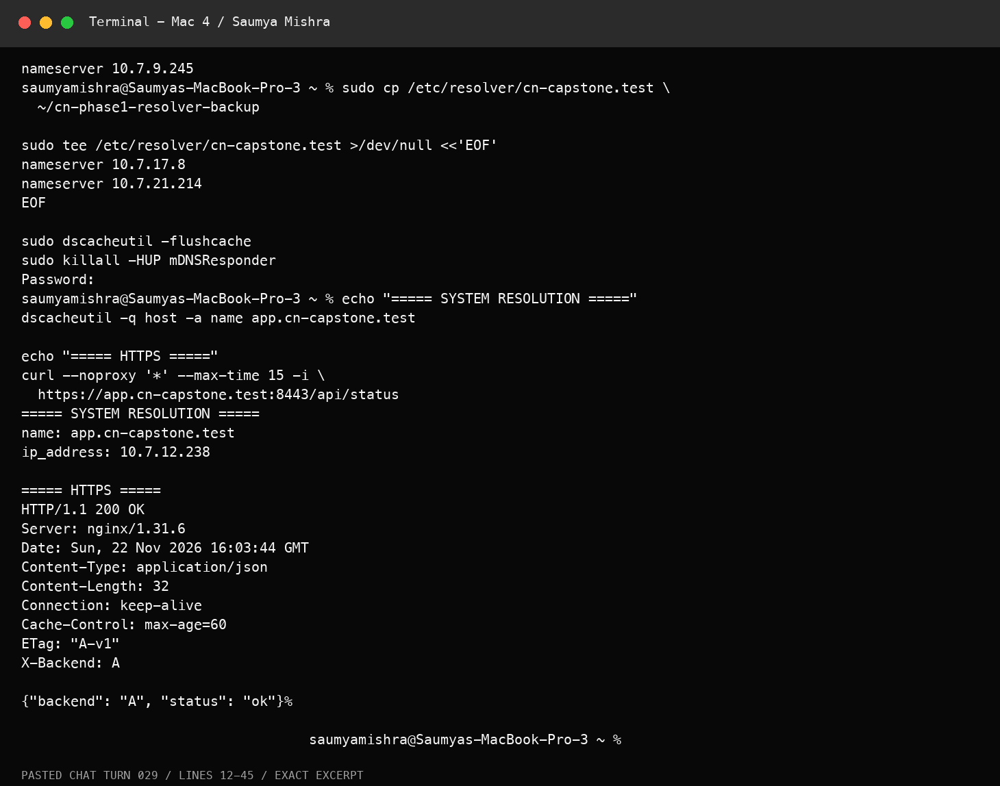

### 04 Backup Dns Answer - Mac 4 / Saumya Mishra

**Supports:** Backup DNS directly answers the project name. Source: pasted turn 031, lines 18-43.

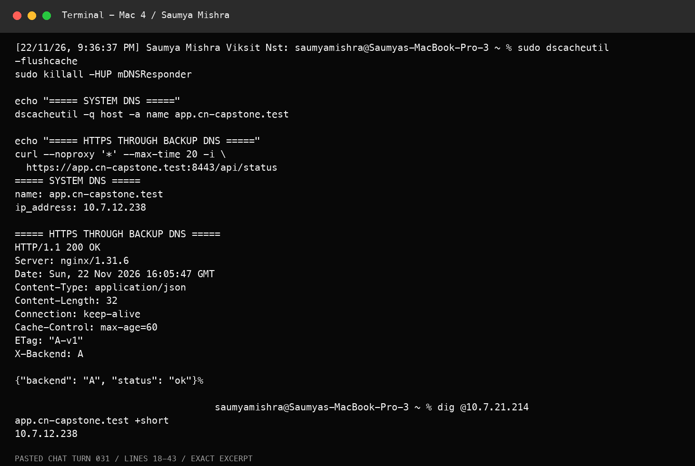

### 05 Ttl Cache Expiry - Mac 2 / Krishna

**Supports:** Old cached answer at TTL 1, then new address after expiry. Source: pasted turn 065, lines 93-160.

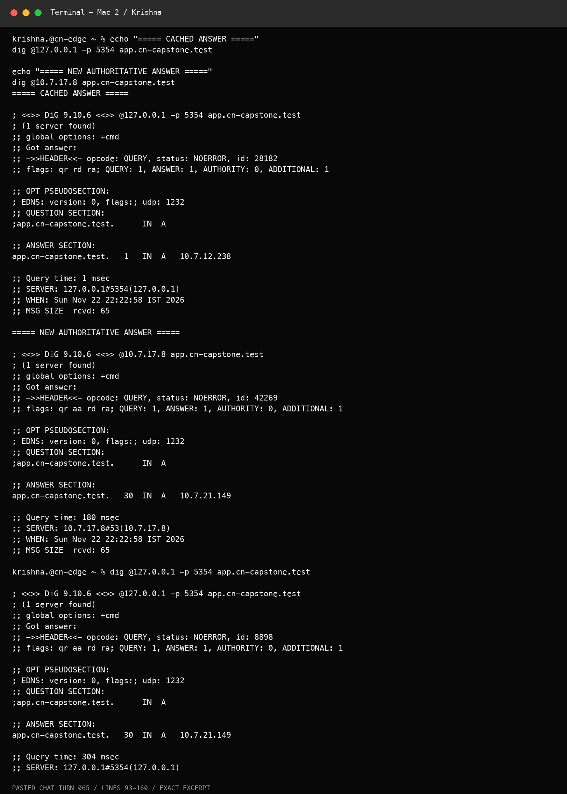

### 06 Firewall Backend A - Mac 3 / Rachit Gupta

**Supports:** Backend A pf rules active. Source: pasted turn 039, lines 20-39.

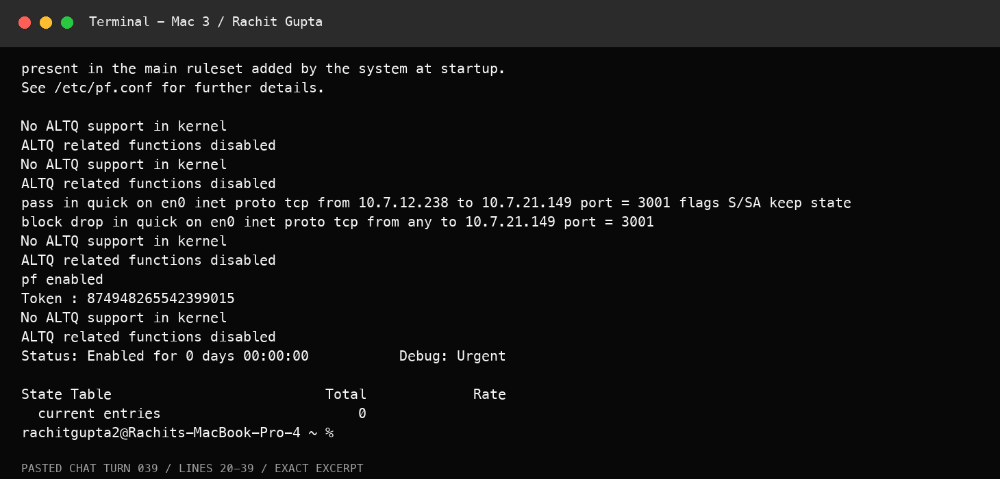

### 07 Firewall Backend B - Mac 4 / Saumya Mishra

**Supports:** Backend B pf rules active. Source: pasted turn 039, lines 60-80.

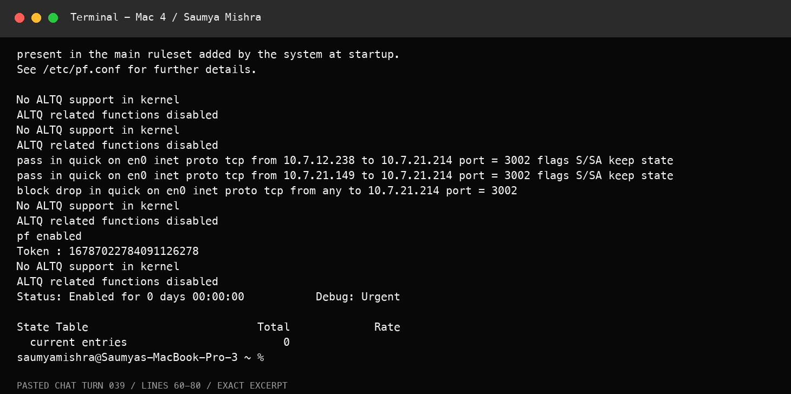

### 08 Edge Backend Access - Mac 2 / Krishna

**Supports:** Edge obtains HTTP 200 from both backend ports. Source: pasted turn 039, lines 81-106.

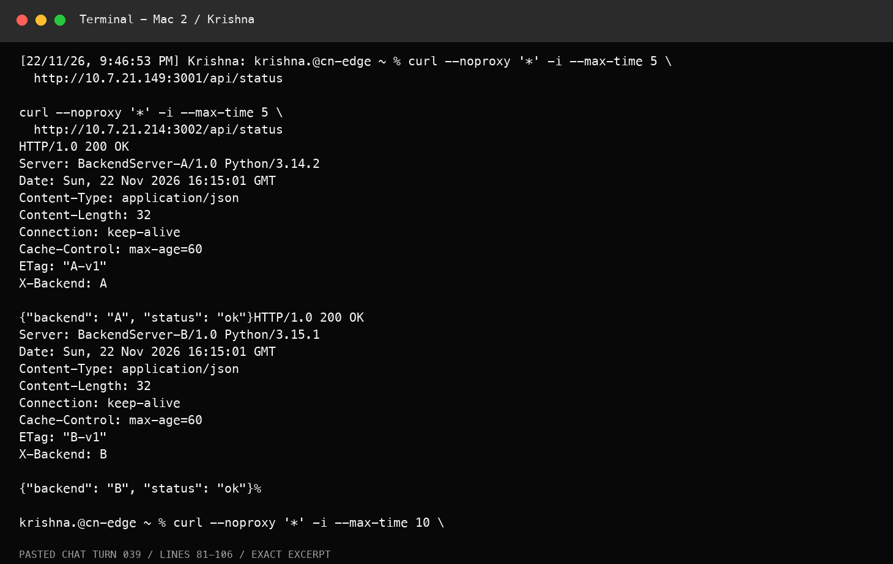

### 09 Client Direct Access Denied - Mac 1 / Aditya Rana

**Supports:** Non-edge client TCP probes to 3001 and 3002 time out. Source: pasted turn 041, lines 1-8.

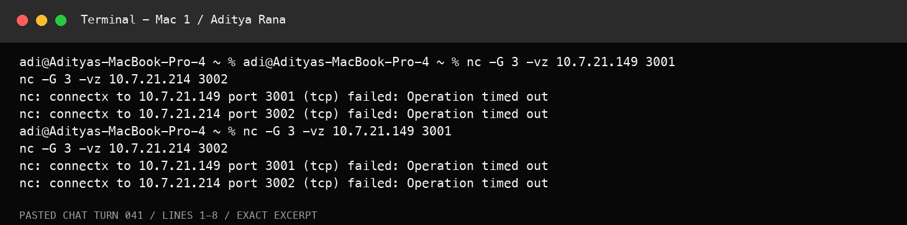

### 10 Backend A Down - Mac 2 / Krishna

**Supports:** Six HTTP 200 responses served by B during A outage. Source: pasted turn 033, lines 1-49.

### 11 Backend A Restored - Mac 2 / Krishna

**Supports:** A appears again after recovery. Source: pasted turn 035, lines 49-97.

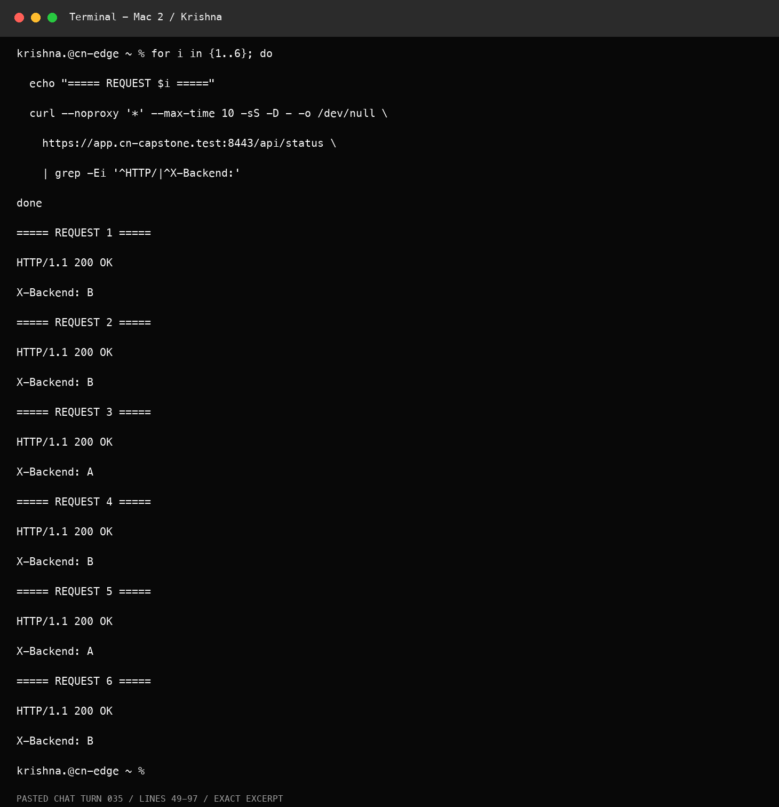

### 12 Standby Edge - Mac 3 / Rachit Gupta

**Supports:** Standby nginx listens on 8443 and serves HTTPS. Source: pasted turn 057, lines 30-64.

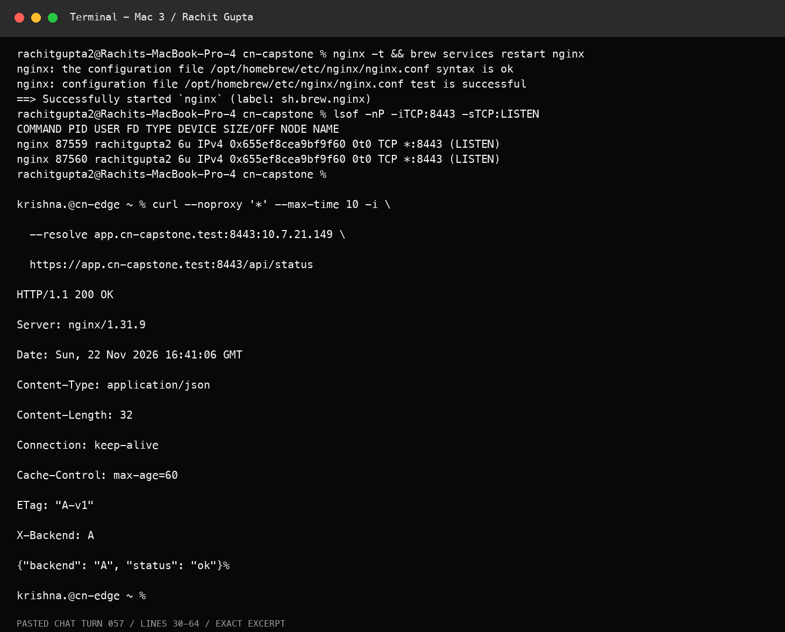

### 13 Dns Cutover - Team / edge migration

**Supports:** Both DNS servers answer Mac 3; domain HTTPS returns HTTP 200. Source: pasted turn 059, lines 5-20.

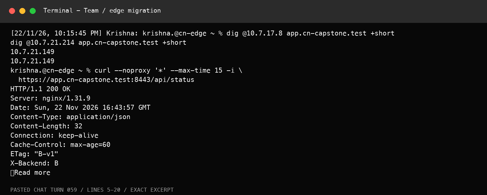

### 14 Dns Restored - Mac 2 / Krishna

**Supports:** Both DNS servers and domain HTTPS return to Mac 2. Source: pasted turn 061, lines 1-25.

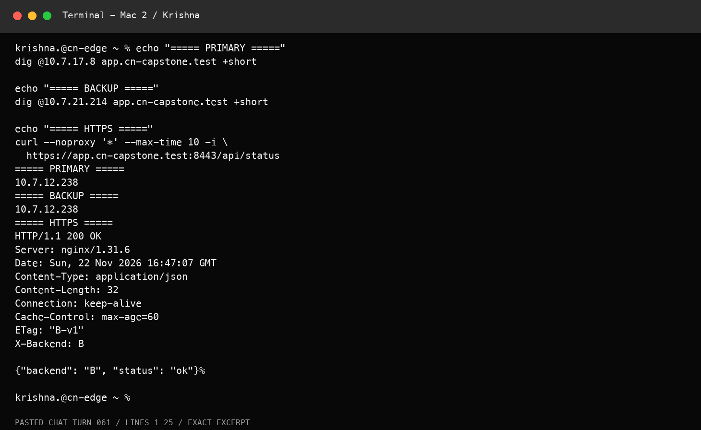

## 6. Final demonstration and remaining live proof

| Step | Show during evaluation |
|---|---|
| 1-2 | Diagram, four current IPs and ports, then pairwise LAN ping |
| 3-4 | Client DNS answer and trusted HTTPS by domain, without insecure flags |
| 5-7 | A/B responses, Phase 1 DNS/TCP/TLS packet captures, cache headers and 304 |
| 8 | Stop Backend A, show B-only HTTP 200, restart A and show A/B |
| 9 | Backup DNS during primary-down state, TTL expiry and cache flush, then edge cutover |
| 10 | Diagnose the faculty fault in DNS -> TCP -> TLS -> HTTP order |
| 11 | Each team member explains their machine and the full request path |

**Still to capture live:** (1) a client resolving through Mac 4 while Mac 1 dnsmasq stays stopped; (2) an immediate changed answer after a verified macOS cache flush; (3) a cached client still reaching the old edge during cutover; (4) pf restoration and verification; and (5) the faculty-injected fault. The pasted logs do not establish these outcomes. The Phase 1 unified script was not rerun on this workspace's physical LAN.

**Diagnosis order:** `dig` against both project resolvers -> TCP probe to selected edge :8443 -> verified TLS handshake with the project certificate -> HTTP status and X-Backend -> nginx/backend logs.

## 7. Sources

- [Pasted terminal conversation](https://chatgpt.com/share/6b03b06a-dd40-83e8-9bf8-6fcc23ebb9a0)
- Course specification: `CN_Project_Doc (1).pdf`, sections 7-10.
- Phase 1 PDFs and packet captures remain in `documentation/` and `evidence/`.
- This report, its 14 PNG figures, and the PDF are regenerated by `phase2/tools/build_report.py`.
